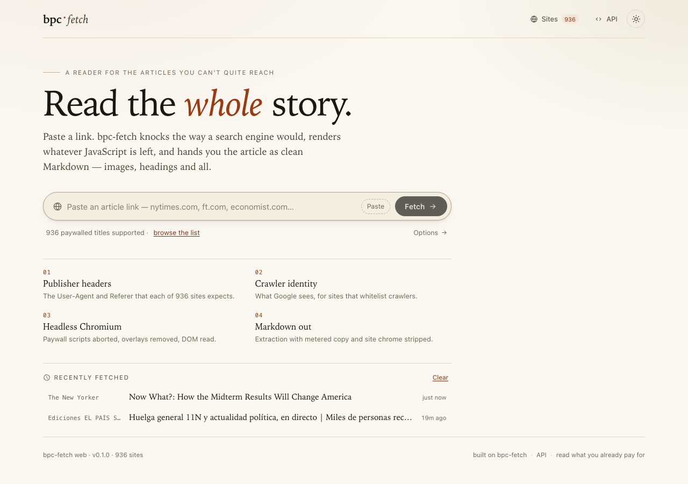

# bpc-fetch web

A self-hosted web front end for [bpc-fetch](https://github.com/Sophomoresty/bpc-fetch):
paste a link, read the article as clean Markdown. Backed by FastAPI, driven by a
React + Vite front end, packaged with **uv**.

```
┌──────────────┐    POST /api/fetch     ┌────────────────────────────────────┐
│  Browser UI  │ ─────────────────────► │  FastAPI  →  fetch pipeline        │
│ React + Vite │ ◄───── poll job ────── │   1. site strategy headers         │
└──────────────┘                        │   2. crawler User-Agent            │
                                        │   3. headless Chromium (JS walls)  │
                                        │   4. Wayback Machine               │
                                        │  → trafilatura → Markdown          │
                                        └────────────────────────────────────┘
```




## Quick start

```bash
git clone <this repo> && cd bpc-fetch-web

make install        # uv sync + Playwright Chromium + npm install
make serve          # builds the UI, serves on http://127.0.0.1:8000
```

Without make:

```bash
uv sync
uv run playwright install chromium      # only needed for JS paywalls
cd web && npm install && npm run build && cd ..
uv run bpc-web                          # http://127.0.0.1:8000
```

A fetch you can point at a real article:

```bash
curl -s -X POST localhost:8000/api/fetch -H 'content-type: application/json' \
  -d '{"url":"https://www.nytimes.com/..."}' | python -m json.tool
```

Development with HMR:

```bash
uv run bpc-web --dev        # API on :8000, auto-reload
cd web && npm run dev       # UI on :5173, proxies /api to :8000
```

## What it does

- **936 supported sites** (the Bypass Paywalls Clean table: NYT, WSJ, FT,
  The Economist, Le Monde, FAZ, Bloomberg, Wired, ...) — each gets the header
  trick that actually works for it: Googlebot UA, custom UA, `Referer` spoofing,
  `X-Forwarded-For`, or JS-wall blocking.
- **Auto-escalating fallback chain.** Direct request → crawler UA → headless
  Chromium with paywall SDKs (`piano.io`, `poool.fr`, `zephr.com`, ...) aborted
  and overlays removed → Wayback Machine. The fullest extraction wins.
- **Real Markdown out.** Headings, links, images, tables, blockquotes — not
  flattened text. Front matter has title/author/date/source.
- **Reader UI** with copy, `.md` download, raw view, reading time, fetch
  trace (which stage won and why), and a searchable list of supported sites.
- **Image proxy** so article images render even when the CDN checks `Referer`.

## API

| Method | Path | Purpose |
|---|---|---|
| `POST` | `/api/fetch` | `{url, force_browser?, skip_browser?, use_archive?, include_images?}` → `{job_id}` |
| `GET` | `/api/fetch/{job_id}` | job status, step trace, article |
| `GET` | `/api/fetch/{job_id}/markdown` | `.md` download with front matter |
| `GET` | `/api/sites?q=&limit=&offset=` | search the supported-site table |
| `GET` | `/api/lookup?url=` | does this URL have a strategy? which? |
| `GET` | `/api/image?url=&ref=` | image proxy (Referer-safe) |
| `GET` | `/api/health` | version, site count, Playwright status |

Interactive docs at `/docs`.

```bash
curl -s -X POST localhost:8000/api/fetch \
  -H 'content-type: application/json' \
  -d '{"url":"https://www.economist.com/..."}' | jq -r .job_id
```

## Configuration

| Env var | Default | Meaning |
|---|---|---|
| `BPC_MAX_CONCURRENT` | `4` | Parallel fetches |
| `BPC_BROWSER_CONTEXTS` | `2` | Chromium contexts in the pool |
| `BPC_RATE_LIMIT` | `40` | Requests per IP per 10 minutes |
| `BPC_DISABLE_RATE_LIMIT` | – | Set to `1` to disable |
| `BPC_CORS_ORIGINS` | `localhost:5173,...` | Dev CORS origins |

## Layout

```
src/bpc_web/
  main.py      FastAPI app, API routes, static mount
  fetcher.py   the fallback pipeline + progress events
  extract.py   HTML → Markdown (trafilatura, JSON-LD metadata, cleanup)
  browser.py   Playwright pool, route blocking, overlay removal, DOM read
  jobs.py      in-memory job store, TTL cache, rate limiter
  vendor/      header strategies + sites.js parser (from bpc-fetch)
  data/sites.js  the 936-site table
web/           React + TypeScript + Vite front end
docs/screenshots/  UI captures used above
tests/         pytest: parser, URL handling, extraction, API smoke
```

## Limitations

- Sites behind a **hard login** (Bloomberg terminal, some FT subscriber-only
  paths) can't be read — no headers or DOM tricks beat an auth server.
- Chromium must be installed for JS paywalls (`uv run playwright install chromium`).
- Jobs and cache are in-memory: restart clears them, and it's single-process
  by design. Put a real queue in front if you need horizontal scale.
- Respect the sites you read, and your local law. Personal reading only.

## License

MIT for this code. The header-strategy logic and the site table are adapted
from bpc-fetch (MIT) — see [NOTICE](NOTICE). The table originates in Bypass
Paywalls Clean (GPL-3.0); it is consumed here as data only.
