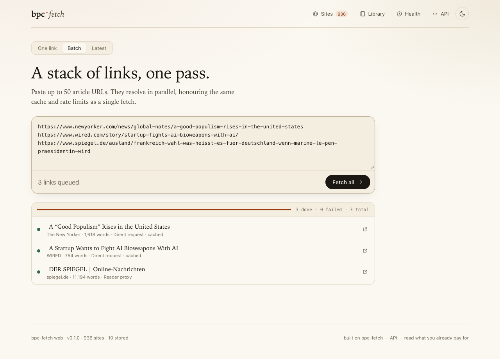
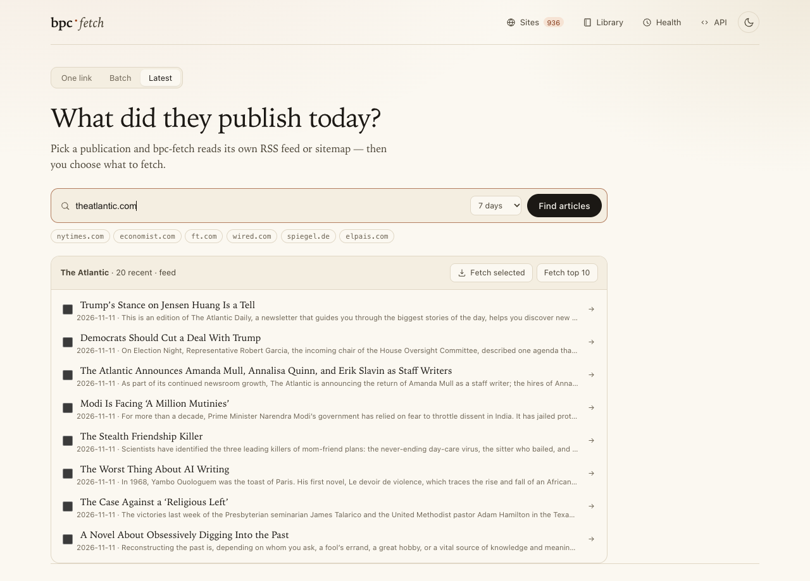
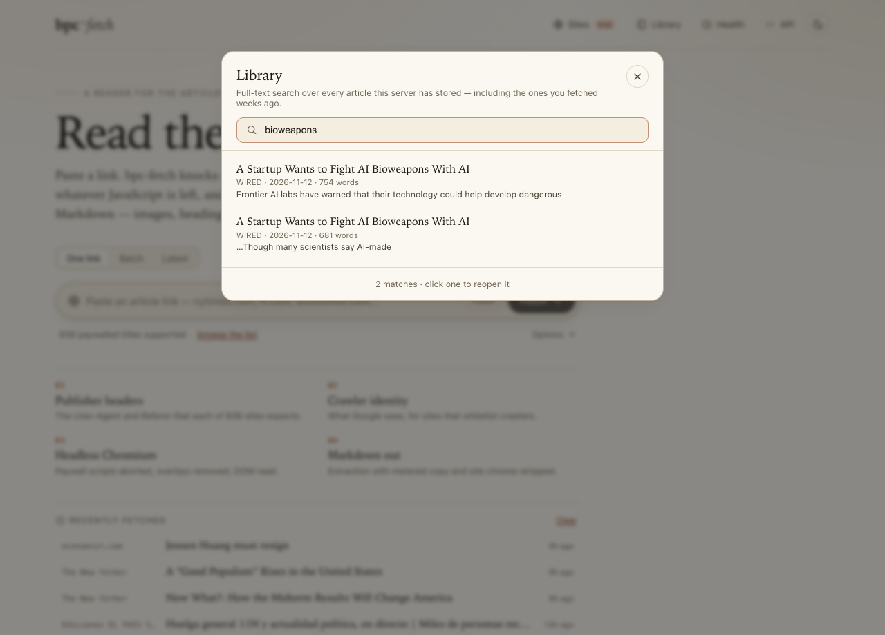
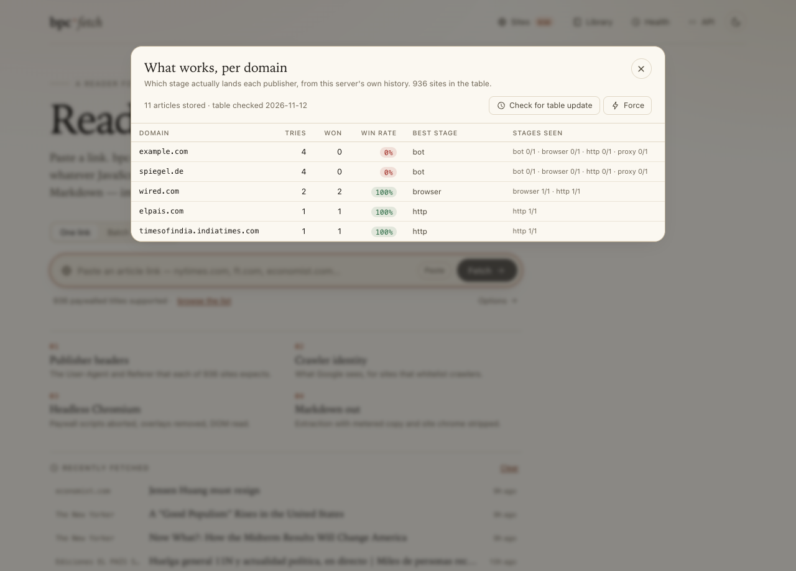

# Offprint

An **offprint** is a single article printed out of a larger publication. That is
what this does: paste a link, get that article back as clean Markdown — no
chrome, no meter, no subscription wall.

Offprint is a self-hosted web front end for
[bpc-fetch](https://github.com/Sophomoresty/bpc-fetch). FastAPI behind a
React + Vite reader, packaged with **uv**.

```
┌──────────────┐    POST /api/fetch     ┌─────────────────────────────────────────┐
│  Browser UI  │ ─────────────────────► │  FastAPI  →  fetch pipeline             │
│ React + Vite │ ◄───── poll job ────── │   1. site strategy headers              │
└──────────────┘                        │   2. crawler User-Agent                 │
                                        │   3. headless Chromium (JS walls)       │
      permalink ──► SQLite              │   4. reader proxy (foreign IP, opt-out) │
                                        │   5. Wayback Machine                    │
                                        │  → trafilatura → Markdown               │
                                        └─────────────────────────────────────────┘
```


| Batch | Discovery |
|---|---|
|  |  |

| Library search | Domain health |
|---|---|
|  |  |

## Quick start

```bash
git clone <this repo> && cd offprint

make install        # uv sync + Playwright Chromium + npm install
make serve          # builds the UI, serves on http://127.0.0.1:8000
```

Without make:

```bash
uv sync
uv run playwright install chromium      # only needed for JS paywalls
cd web && npm install && npm run build && cd ..
uv run offprint                          # http://127.0.0.1:8000
```

A fetch you can point at a real article:

```bash
curl -s -X POST localhost:8000/api/fetch -H 'content-type: application/json' \
  -d '{"url":"https://www.nytimes.com/..."}' | python -m json.tool
```

Development with HMR:

```bash
uv run offprint --dev        # API on :8000, auto-reload
cd web && npm run dev       # UI on :5173, proxies /api to :8000
```

## What it does

- **Batch mode** — paste up to 50 links, they resolve in parallel through the same
  cache and rate limiter, with per-item status and one click into any result.
- **Discovery** — point it at a publication and it reads that site's own RSS feed
  (or sitemap) to list what it published today/this week; fetch one, or batch the lot.
- **Library search** — every fetched article is stored in SQLite with an FTS5 index,
  so you can full-text search things you read weeks ago.
- **Export** — `.md`, **EPUB** (with images) and **PDF** (rendered by Chromium,
  images downscaled) straight from the reader.
- **Health view** — which stage actually lands each publisher, from this server's
  own history, plus a button to refresh the site table from upstream.
- **936 supported sites** (the Bypass Paywalls Clean table: NYT, WSJ, FT,
  The Economist, Le Monde, FAZ, Bloomberg, Wired, ...) — each gets the header
  trick that actually works for it: Googlebot UA, custom UA, `Referer` spoofing,
  `X-Forwarded-For`, or JS-wall blocking.
- **Auto-escalating fallback chain.** Direct request → crawler UA → headless
  Chromium with paywall SDKs (`piano.io`, `poool.fr`, `zephr.com`, ...) aborted
  and overlays removed → reader proxy → Wayback Machine. The fullest extraction
  wins, and a hard Cloudflare/DataDome wall skips straight to the proxy instead
  of spending 25 seconds proving a local browser can't get through.
- **Honest about previews.** When a page is metered (The Economist, SMH, most
  Condé Nast titles past the limit) the UI says *preview only* instead of
  presenting a truncated body as the whole article.
- **Persistence + permalinks.** Articles land in SQLite, so a `?a=<id>` link
  reopens instantly, the `.md` download survives restarts, and re-fetching the
  same URL with the same options answers from the store.
- **Real Markdown out.** Headings, links, images, tables, blockquotes — not
  flattened text. Front matter has title/author/date/source.
- **Reader UI** with copy, `.md` download, raw view, reading time, fetch
  trace (which stage won and why), and a searchable list of supported sites.
- **Image proxy** so article images render even when the CDN checks `Referer`.

## API

| Method | Path | Purpose |
|---|---|---|
| `POST` | `/api/fetch` | `{url, force_browser?, skip_browser?, use_archive?, include_images?}` → `{job_id}` |
| `GET` | `/api/fetch/{job_id}` | job status, step trace, article |
| `GET` | `/api/fetch/{job_id}/markdown` | `.md` download with front matter |
| `POST` | `/api/batch` | `{urls: [...]}` → `{id}` (up to 50, parallel) |
| `GET` | `/api/batch/{id}` | per-item status for a batch |
| `GET` | `/api/discover?site=&since=7d&limit=` | recent articles via RSS/sitemap |
| `GET` | `/api/search?q=` | full-text search over stored articles |
| `GET` | `/api/stats` | per-domain stage outcomes |
| `GET` | `/api/articles/{id}/epub` | EPUB export |
| `GET` | `/api/articles/{id}/pdf` | PDF export (Chromium) |
| `POST` | `/api/sites/update?force=` | refresh the site table from upstream |
| `GET` | `/api/sites?q=&limit=&offset=` | search the supported-site table |
| `GET` | `/api/lookup?url=` | does this URL have a strategy? which? |
| `GET` | `/api/image?url=&ref=` | image proxy (Referer-safe) |
| `GET` | `/api/articles/{id}` | a stored article (permalink target) |
| `GET` | `/api/articles/{id}/markdown` | `.md` download from the store |
| `GET` | `/api/recent?limit=` | recently stored articles |
| `GET` | `/api/health` | version, site count, Playwright status, articles stored |

Interactive docs at `/docs`.

```bash
curl -s -X POST localhost:8000/api/fetch \
  -H 'content-type: application/json' \
  -d '{"url":"https://www.economist.com/..."}' | jq -r .job_id
```

## Configuration

| Env var | Default | Meaning |
|---|---|---|
| `OFFPRINT_MAX_CONCURRENT` | `4` | Parallel fetches |
| `OFFPRINT_BROWSER_CONTEXTS` | `2` | Chromium contexts in the pool |
| `OFFPRINT_RATE_LIMIT` | `40` | Requests per IP per 10 minutes |
| `OFFPRINT_DISABLE_RATE_LIMIT` | – | Set to `1` to disable |
| `OFFPRINT_CORS_ORIGINS` | `localhost:5173,...` | Dev CORS origins |
| `OFFPRINT_READER_PROXY` | `1` | Enable the reader-proxy stage (set `0` to disable) |
| `OFFPRINT_READER_PROXY_TOKEN` | – | Bearer token for the proxy's higher rate limits |
| `OFFPRINT_READER_PROXY_URL` | `https://r.jina.ai/` | Point at a self-hosted reader instead |
| `OFFPRINT_HEADFUL` | `0` | `1` runs Chromium with a window (local use, passes more challenges) |
| `OFFPRINT_CHALLENGE_WAIT_MS` | `14000` | How long to wait for a JS interstitial to clear |
| `OFFPRINT_DB_PATH` | `~/.cache/offprint/articles.db` | Article store location |
| `OFFPRINT_CDP_URL` | – | Attach to a remote Chromium (`http://browser:9222`) instead of launching one |
| `OFFPRINT_SITES_AUTOUPDATE` | `0` | `1` checks upstream for a new site table at boot + daily |
| `OFFPRINT_SITES_UPDATE_URL` | bpc-fetch raw GitHub | Where to pull the table from |
| `OFFPRINT_SITES_JS` | bundled copy | Writable path for the site table (set in Docker) |
| `OFFPRINT_ADMIN_TOKEN` | – | If set, `/api/sites/update` requires `X-Admin-Token` |

## Docker

The app and the browser can run as separate containers: the app attaches to
Chromium over CDP, so a browser crash or restart doesn't take the API with it.

```bash
docker compose up --build      # http://localhost:8000
```

- `app` — FastAPI + built UI, articles and the site table on the `bpc-data` volume
- `browser` — headless Chromium exposing CDP on :9222 (`OFFPRINT_CDP_URL` points at it)
- Chromium is installed in the image either way, so `docker run` alone works too.

## Layout

```
src/offprint/
  main.py      FastAPI app, API routes, static mount
  fetcher.py   the fallback pipeline + progress events
  extract.py   HTML → Markdown (trafilatura, JSON-LD metadata, cleanup)
  browser.py   Playwright pool, route blocking, overlay removal, DOM read
  jobs.py      in-memory job store, TTL cache, rate limiter
  batch.py     batch store: many URLs, one id, per-item status
  discover.py  RSS/Atom + sitemap discovery, with a known-feed table
  export.py    EPUB builder and PDF print document
  proxy.py     reader-proxy stage (Jina envelope -> Markdown, prose window)
  sites_updater.py  pull the site table from upstream, validate, swap, reset cache
  store.py     SQLite article store: permalinks, cross-restart cache
  vendor/      header strategies + sites.js parser (from bpc-fetch)
  data/sites.js  the 936-site table
web/           React + TypeScript + Vite front end
docs/screenshots/  UI captures used above
tests/         pytest: parser, URL handling, extraction, API smoke
```

## Limits, stated plainly

- **Metered articles stay metered.** The Economist hands over the first ~100
  words and nothing else; the reader shows exactly that and labels it a preview.
  No header trick, browser or proxy changes a subscription gate.
- **IP-reputation walls.** Cloudflare ("Just a moment…") and DataDome (NYT) score
  the *network*, not just the fingerprint. From a blocked IP — several VPNs and
  datacenter ranges — the direct, crawler and browser stages all 403. That is why
  the reader proxy exists; if you'd rather not use it, `OFFPRINT_READER_PROXY=0`.
- **The reader proxy is a third party.** When that stage runs, the article URL is
  sent to `r.jina.ai` (or whichever `OFFPRINT_READER_PROXY_URL` you set). The trace
  says "Reader proxy" so you always know. Self-host a reader and point the env
  var at it if that matters to you.
- **Hard logins** (Bloomberg terminal, FT subscriber paths) are unreachable — no
  tricks beat an auth server.
- Chromium must be installed for JS paywalls (`uv run playwright install chromium`).
- Jobs are in-memory and the app is single-process by design; articles persist in
  SQLite, but progress traces don't survive a restart. Put a real queue in front
  if you need horizontal scale.
- Respect the sites you read, and your local law. Personal reading only.

## License

MIT for this code. The header-strategy logic and the site table are adapted
from bpc-fetch (MIT) — see [NOTICE](NOTICE). The table originates in Bypass
Paywalls Clean (GPL-3.0); it is consumed here as data only.
